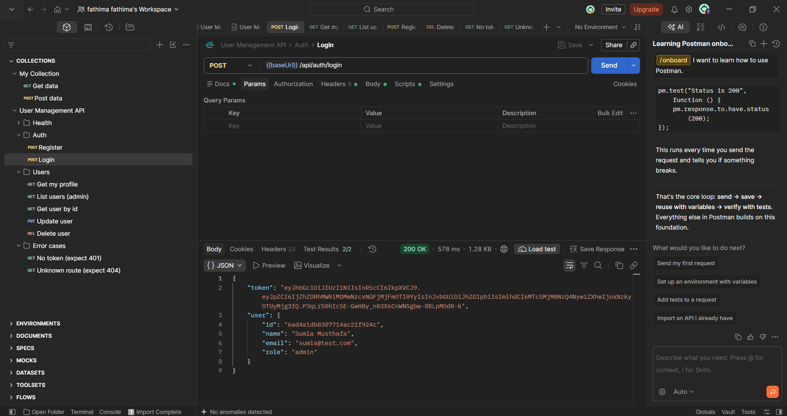
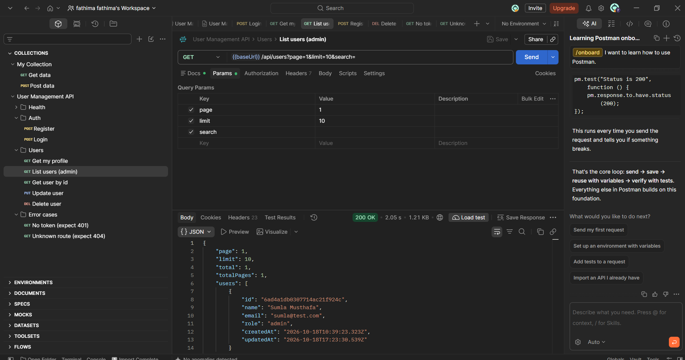
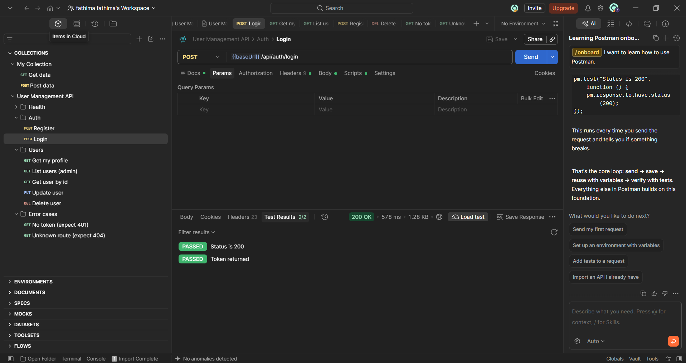

# User Management API

A secure REST API for user registration, authentication and management, built with **Node.js, Express and MongoDB**. Includes JWT authentication, role-based access control, pagination, search, centralized error handling and rate limiting.

Built as part of the **Syntecxhub Web Development Internship (Week 2)**.

**Live API:** `https://syntecxhub-user-management-system-eta.vercel.app`

## Features

- Register and login with **JWT** authentication
- Passwords hashed with **bcrypt**
- **Role-based access control** (`user` and `admin`)
- Protected routes with a reusable auth middleware
- Full **CRUD** for users with input validation
- **Pagination and search** on the users list
- Centralized **error handling** with consistent JSON responses
- **Rate limiting** (stricter on auth routes to slow down brute-force attacks)
- Security headers with **Helmet**, **CORS** enabled

## Tech Stack

Node.js, Express, MongoDB Atlas, Mongoose, JSON Web Tokens, bcryptjs, Helmet, CORS, Morgan, express-rate-limit

## API Endpoints

| Method | Endpoint | Access | Description |
|---|---|---|---|
| POST | `/api/auth/register` | Public | Register a new user |
| POST | `/api/auth/login` | Public | Login and receive a JWT |
| GET | `/api/users/me` | Logged in | Get the current user's profile |
| GET | `/api/users` | Admin | List users (`?page=1&limit=10&search=name`) |
| GET | `/api/users/:id` | Self or admin | Get one user |
| PUT | `/api/users/:id` | Self or admin | Update a user (only an admin can change `role`) |
| DELETE | `/api/users/:id` | Self or admin | Delete a user |

Protected routes need the header: `Authorization: Bearer <token>`

### Example

```http
POST /api/auth/login
Content-Type: application/json

{
  "email": "user@example.com",
  "password": "your-password"
}
```

Response:

```json
{
  "token": "<jwt>",
  "user": { "id": "...", "name": "...", "email": "...", "role": "user" }
}
```

### Error format

Every error returns the same shape:

```json
{ "message": "Not authorized, token missing" }
```

| Status | Meaning |
|---|---|
| 400 | Validation error or invalid input |
| 401 | Missing or invalid token / wrong credentials |
| 403 | Not allowed for your role |
| 404 | Route or user not found |
| 409 | Email already registered |
| 429 | Too many requests (rate limit) |

Rate limits: 100 requests per 15 minutes on `/api`, 10 requests per 15 minutes on `/api/auth`.

## Getting Started

### Prerequisites

- Node.js 18 or newer
- A MongoDB database (MongoDB Atlas free tier works)

### Installation

```bash
git clone https://github.com/sumlamusthafa/Syntecxhub_User_Management_System.git
cd Syntecxhub_User_Management_System
npm install
```

### Environment variables

Copy `.env.example` to `.env` and fill in your values:

```env
PORT=5000
MONGO_URI=your_mongodb_connection_string
JWT_SECRET=a_long_random_secret
JWT_EXPIRES_IN=7d
```

### Run

```bash
npm run dev     # development (nodemon)
npm start       # production
```

The API runs on `http://localhost:5000`.

### Creating an admin

For safety, the `role` can never be set through registration. To make an admin, change a user's `role` to `admin` directly in the database.

## Testing with Postman

Import `postman/User_Management_API.postman_collection.json` into Postman:

1. Open the collection **Variables** tab and set `email` and `password` (an existing user).
2. Run **Auth > Login**. The token is saved automatically.
3. Run any other request.

## Screenshots

**Login**



**List users (admin, with pagination)**



**Automated tests passing**



## Project Structure

```
├── config/        # database connection
├── controllers/   # request handlers (auth, users)
├── middleware/    # auth, error handling, rate limiting
├── models/        # Mongoose schemas
├── routes/        # route definitions
├── postman/       # Postman collection
├── screenshots/   # README images
└── server.js      # app entry point
```

## Author

**MM Fathima Sumla**
GitHub: [@sumlamusthafa](https://github.com/sumlamusthafa)